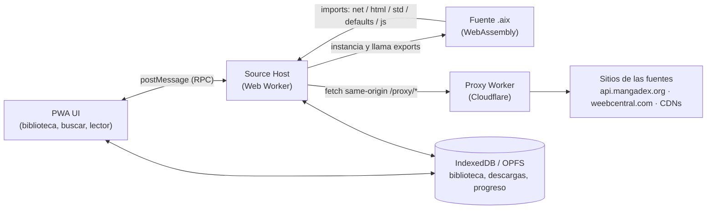

# SPEC v0.1 — Tinta, lector PWA compatible con Aidoku

- **Estado:** borrador para revisión (2026-10-14)
- **Repo:** `Angelus-GS/Tinta`
- **Idea en una línea:** un lector de manga como PWA que actúa como *host* de fuentes
  Aidoku (`.aix`, WebAssembly) en el navegador — no un port de KOReader.

---

## 1. Objetivo

Construir una aplicación web instalable (PWA), offline-first, capaz de:

1. Instalar fuentes desde listas de fuentes compatibles con Aidoku
   (`index.min.json` + paquetes `.aix`).
2. Ejecutar el WebAssembly de cada fuente en un Web Worker, implementando en
   JavaScript/TypeScript los *imports* que el ABI de Aidoku exige al host.
3. Buscar manga, ver detalle y capítulos, leer páginas en línea y descargar
   capítulos para lectura offline.

### 1.1 No-objetivos (fuera de alcance)

- No es un port de KOReader: no se porta Lua, LuaJIT, CREngine ni MuPDF.
- No ejecuta plugins `.koplugin` de Lua (incluido Rakuyomi como binario nativo:
  su backend Rust con socket Unix y SQLite no existe en un navegador).
- No soporta fuentes que requieran **webview** interactivo (login o reto
  anti-bot en página real). Esos imports se devuelven como no soportados,
  igual que hace Rakuyomi.
- No evade DRM, paywalls ni protecciones anti-bot. Solo se automatiza el
  acceso a sitios que el usuario puede abrir y leer en su navegador.
- EPUB/PDF locales no son parte del MVP (fase posterior, ver §9).
- **No se toca el repo `vive-la-resistance`** (app en producción del
  usuario): el lector vive en repo y despliegue propios. La alternativa de
  meterlo como módulo dentro de esa app quedó descartada por riesgo.

## 2. Fuentes de aceptación (criterio de “funciona”)

El host se considera correcto solo si corre **las dos**, sin código especial
para ninguna:

| Fuente | Tipo | Qué ejercita del host |
|---|---|---|
| **MangaDex** (`multi.mangadex`) | API REST / JSON | `net` (incl. `send_all`, `set_body`, rate-limit), `defaults` (get/set), `std` (fechas), postcard |
| **Weeb Central** (`en.weebcentral`) | Scraper HTML | Módulo `html` completo (selectores CSS, `text`, `attr`, navegación), `net.html`, `send_partial_result` |

Ambas existen como `.aix` verificados a nivel binario en la literatura del ABI
(MangaDex v12, Weeb Central v6, auditados el 2026-02-19 en el loader de
referencia citado en §12). Se fijarán (*pin*) los `.aix` exactos descargados de
la lista oficial de Aidoku Community Sources como *fixtures* de prueba.

### 2.1 Flujos de aceptación por fuente

Para cada fuente de aceptación, de principio a fin:

1. Instalar desde la lista de fuentes.
2. `get_search_manga_list`: buscar un título conocido y obtener resultados
   con portada.
3. `get_manga_update`: abrir un título y obtener detalle + lista de capítulos.
4. `get_page_list`: abrir un capítulo y obtener todas sus páginas.
5. Leer el capítulo en el lector (paginado, dirección RTL).
6. Descargar el capítulo y leerlo offline (modo avión).

## 3. Arquitectura general



### 3.1 Componentes

| Componente | Responsabilidad |
|---|---|
| **App shell (PWA)** | UI, service worker, manifest, caché del shell. |
| **Source Manager** | Descargar listas (`index.min.json`), instalar/actualizar/desinstalar `.aix`, leer su manifiesto. |
| **WASM Host (Worker)** | Instanciar fuentes, registry de buffers (RID), implementar imports, decodificar resultados postcard. |
| **Postcard codec** | Codificar/decodificar los tipos de aidoku-rs (ver §5). |
| **Proxy** | Reenviar peticiones sin CORS (ver §6). |
| **Library Store** | Persistencia local (ver §7). |
| **Reader** | Presentación de páginas (ver §8). |
| **Downloader** | Cola de descargas de capítulos a OPFS, reanudable. |

## 4. Formato `.aix`

Un `.aix` es un ZIP con rutas con `/` (forward slashes obligatorios):

```
Payload/main.wasm     # la fuente compilada (wasm32-unknown-unknown)
Payload/icon.png      # icono instalado (si falta, placeholder)
Payload/source.json   # manifiesto: info.id, info.name, info.version, info.url,
                      #   info.languages, info.contentRating; listings y config opcionales
Payload/filters.json  # filtros de búsqueda (opcional)
Payload/settings.json # definiciones de ajustes de la fuente (opcional)
```

> **Errata verificada en Fase 0 (2026-10-15)** contra los paquetes reales del
> catálogo comunitario (MangaDex v14, Weeb Central v8): TODO vive dentro de
> `Payload/` — no existe carpeta `res/` en los paquetes actuales, aunque
> documentación de terceros la mencione. La instalación debe aceptar ambas
> rutas (`Payload/` preferente, `res/` como respaldo), pero la canónica es
> `Payload/`.

La instalación valida: ZIP íntegro, `main.wasm` presente y compilable,
`source.json` válido contra el esquema de aidoku-rs, e icono si existe.

## 5. Contrato ABI con las fuentes

Referencia: ABI de aidoku-rs (SDK “next”) tal como fue verificado contra los
binarios reales de MangaDex, Weeb Central, AsuraScans y MangaFire.

### 5.1 Exports (el host llama a la fuente)

Todos devuelven `i32`: positivo = puntero a buffer de resultado en memoria
lineal (`[u32 len LE][u32 capacity LE][payload postcard]`); cero = éxito sin
payload; negativo = error (`-1` general, `-2` no soportado, `-3` login
requerido). El host debe llamar `free_result(ptr)` al terminar.

Obligatorios (trait `Source`):

| Export | Parámetros | Devuelve |
|---|---|---|
| `start` | — | Inicializa la fuente; se llama antes que todo. |
| `get_search_manga_list` | `query_rid, page (1-indexado), filters_rid` | `MangaPageResult` |
| `get_manga_update` | `manga_key_rid, needs_details, needs_chapters` | `Manga` (detalle y/o capítulos) |
| `get_page_list` | `manga_descriptor_rid, chapter_descriptor_rid` | Lista de `Page` |

Opcionales (según traits que la fuente implemente): `get_manga_list`,
`get_listings`, `get_home`, `get_filters`, `get_settings`,
`get_alternate_covers`, `get_image_request`, `get_base_url`,
`get_page_description`, `process_page_image`, `handle_notification`,
`handle_deep_link`, `handle_basic_login`, `handle_web_login`,
`handle_key_migration`. El host los invoca solo si el módulo los exporta.

### 5.2 Convención RID

Los parámetros complejos viajan como **RID** (`i32`): el host guarda los bytes
serializados en un registry `Map<RID, Uint8List>`; la fuente lee con
`std.buffer_len(rid)` + `std.read_buffer(rid, ptr, len)` y libera con
`std.destroy(rid)`.

### 5.3 Imports (el host implementa para la fuente)

Cobertura observada en los binarios de aceptación — el host MVP debe
implementar **todos** los marcados, aunque una fuente concreta no los use:

| Módulo | Funciones | Notas |
|---|---|---|
| `env` | `print`, `abort`, `send_partial_result` (+ alias legacy con `_`) | Logs y resultados parciales en streaming. |
| `std` | `destroy`, `buffer_len`, `read_buffer`, `current_date`, `parse_date`, `utc_offset` | `parse_date` debe respetar formato/locale/timezone recibidos. |
| `net` | `init`, `send`, `send_all`, `set_url`, `set_header`, `set_body`, `set_timeout`, `data_len`, `read_data`, `get_status_code`, `get_header`, `html`, `set_rate_limit` | Ver decisión crítica §5.4. Métodos HTTP: `0=GET…5=HEAD`. |
| `html` | `parse`, `parse_fragment`, `select`, `select_first`, `text`, `own_text`, `attr`, `html`, `outer_html`, `size`, `get`, `first`, `last`, `parent`, `children`, `next`, `previous`, `tag_name`, `id`, `class_name` | MangaDex **no** usa este módulo; Weeb Central sí, casi entero. La semántica debe imitar a `scraper`/`ego-tree` de Rust, no a `querySelectorAll` sin más (ver §10 riesgos). |
| `defaults` | `get`, `set` | Persistencia por fuente con namespace `"<sourceId>.<key>"`; valores postcard con discriminante de tipo (Bool=1, Int=2, Float=3, String=4, StringArray=5, Null=6). Sembrar desde `res/settings.json` al instalar. |
| `js` | `context_create`, `context_eval`, `context_get` | Evaluación JS aislada dentro del Worker para fuentes que decodifican contenido ofuscado. MVP: puede devolverse error y marcar la fuente como parcial. |
| `js` (webview) | `webview_create`, `webview_load`, `webview_load_html`, `webview_wait_for_load`, `webview_eval` | **Stub:** devolver `-1` siempre (§1.1). |

### 5.4 ⚠️ Decisión crítica: `net.send` es síncrono, `fetch` no

El ABI espera que `net.send(rid)` bloquee y devuelva la respuesta; en web,
`fetch` es asíncrono y un import de WASM no puede esperar una promesa sin
mecanismo extra. Es **el** riesgo del proyecto. La Fase 0 (§9) es un spike
para elegir y demostrar una de estas rutas, en este orden de preferencia:

1. **JSPI** (WebAssembly JavaScript Promise Integration) — limpio, pero su
   disponibilidad depende del navegador.
2. **Asyncify** (transformación Binaryen del `.aix`) — compatible en más
   navegadores; costo: binario mayor y posible fricción con fuentes futuras.
3. **Worker + `Atomics.wait` + XHR síncrono al proxy** — funciona sin
   transformar binarios; requiere aislamiento cross-origin (COOP/COEP) para
   `SharedArrayBuffer` y un proxy que acepte XHR síncrono.

La decisión y su justificación quedan en un ADR (`docs/adr/0001-net-sync.md`)
antes de escribir el host completo. **Dispositivo objetivo principal influye
directamente en esta elección** (ver §11).

> **Resuelto en Fase 0 (2026-10-15):** detección en runtime — **JSPI**
> cuando el navegador lo trae y **Asyncify** como respaldo; la ruta
> SAB/`Atomics.wait` quedó descartada como mecanismo por defecto porque
> GitHub Pages no puede emitir las cabeceras COOP/COEP que exige. Ver
> ADR-0001 y `spike/FINDINGS.md`. Nota: el spike demostró la semántica con
> HTTP bloqueante en Node; el transporte de navegador se construye en
> Fase 1 sobre esta decisión.

### 5.5 Codec postcard

Los payloads van en **postcard** (formato binario de serde: varints, strings
con longitud prefijada, enums por discriminante `u8`/`varint`). Hay que
implementar encoder/decoder en TS para los tipos de aidoku-rs que cruzan la
frontera (`Manga`, `Chapter`, `Page`, `MangaPageResult`, `FilterValue`,
`Listing`, `HomeComponent`, `ImageRequest`, descriptores…) y probarlo contra
salidas reales capturadas de los `.aix` fixture (golden tests, §10). Las
fuentes fijan revisiones distintas de aidoku-rs en su `Cargo.lock`; el codec
debe tolerar campos añadidos al final de structs (compatibilidad hacia
adelante) y fallar con error legible, nunca con datos corruptos en silencio.

## 6. Proxy anti-CORS

### 6.1 Por qué existe

- `api.mangadex.org` solo envía `Access-Control-Allow-Origin` para orígenes
  `localhost`; una PWA en un dominio público no puede llamarlo directo.
- Weeb Central no ofrece API ni cabeceras CORS útiles para este uso.
- Las portadas de MangaDex (`uploads.mangadex.org`) sí tienen CORS correcto,
  pero las páginas de capítulo se sirven desde nodos *MangaDex@Home* con
  dominios dinámicos.

### 6.2 Diseño (Cloudflare Worker)

- Ruta same-origin: `/proxy/<url codificada>` (o subdominio propio); la PWA
  nunca llama directo a las fuentes para contenido del host WASM.
- **Allowlist estricta:** solo dominios derivados de los manifiestos de las
  fuentes instaladas (`info.url`) + patrones explícitos para CDNs de imagen
  (p. ej. nodos `*.mangadex.network`). Nada de proxy abierto (evita abuso y
  SSRF).
- Cabeceras: fijar `User-Agent`/`Referer` que la fuente pida, reenviar
  cookies solo si la fuente las configuró explícitamente.
- Rate limiting: respetar el `set_rate_limit` que declare cada fuente y los
  límites públicos de MangaDex; caché de portadas/páginas con Cache API.
- Sin credenciales del usuario hacia terceros salvo las que él configure por
  fuente; nada de analítica sobre hábitos de lectura.

## 7. Modelo de datos local

IndexedDB (metadatos) + OPFS (binarios: `.aix` instalados, páginas
descargadas):

| Entidad | Contenido |
|---|---|
| `sources` | id, versión instalada, manifiesto, bytes del `.aix`, ajustes (`defaults`). |
| `sourceLists` | URL de la lista, fecha de refresco, catálogo disponible. |
| `library` | Manga guardados: clave compuesta `(sourceId, mangaKey)`, snapshot de `Manga`, última lectura. |
| `chapters` | Por manga: `Chapter` + estado (leído/en curso), progreso. |
| `downloads` | Capítulo → páginas en OPFS, bytes totales, estado de la descarga. |
| `progress` | `(sourceId, mangaKey, chapterKey)` → página y timestamp (formato propio, exportable). |
| `settings` | Ajustes globales del lector y por fuente. |

Exportación: un capítulo descargado puede exportarse como **CBZ** (las
páginas ya son imágenes ordenadas), para leerlo en KOReader u otro lector.

## 8. Lector

MVP: paginado (una página, dirección RTL y LTR), toque/botones/teclado para
pasar página, precarga de páginas siguientes, zoom básico, modo scroll
vertical como alternativa. Sin animaciones costosas (pensado también para
pantallas de tinta vía navegador del e-reader, sin prometer paridad con una
app nativa).

## 9. Fases

| Fase | Entregable | Criterio de salida |
|---|---|---|
| **0. Spike ABI** ✅ (2026-10-15) | Host mínimo (Node) que carga el `.aix` de MangaDex y corre la cadena completa **contra la API real** (superó el criterio original, que pedía red simulada): buscar → detalle+capítulos → lista de páginas, todo decodificado byte-exacto; ADR-0001 escrito. Ver `spike/FINDINGS.md`. | ✅ Búsqueda, update (929 caps. de One Piece) y páginas (51 de Yotsuba, imagen HTTP 200) verificados. |
| **1. MVP MangaDex** | Source Manager + proxy + host + lector mínimo, MangaDex real de principio a fin. | Flujo §2.1 completo con MangaDex. |
| **2. Weeb Central** | Módulo `html` completo + ajustes del proxy para scraping. | Flujo §2.1 completo con Weeb Central, sin código específico para ella. |
| **3. Biblioteca y offline** | Descargas a OPFS, progreso, exportar CBZ, actualización de fuentes desde la lista. | Leer offline y actualizar una fuente sin perder biblioteca. |
| **4. (Posterior)** | Más fuentes del catálogo, EPUB/PDF locales, sincronización de progreso tipo KOReader Sync. | Fuera del compromiso inicial. |

Estimación honesta (inferencia, no compromiso): Fase 0, días; Fases 1–2,
semanas; Fase 3, semanas. El codec postcard y la semántica de `html` son los
dos frentes que pueden mover la estimación.

## 10. Pruebas

- **Auditoría de imports:** script que lista `WebAssembly.Module.imports()`
  de cada `.aix` fixture y verifica cobertura del host (equivalente web de la
  auditoría con la que se documentó el ABI de referencia).
- **Golden tests de codec:** payloads postcard reales capturados ↔ objetos TS.
- **Fixtures HTTP:** respuestas grabadas de MangaDex y Weeb Central para
  probar fuentes sin tocar la red (y sin martillar los sitios).
- **Aceptación E2E:** el flujo §2.1 automatizado (Playwright) contra el proxy
  de desarrollo, más verificación manual en el dispositivo objetivo.

## 11. Preguntas abiertas

1. **Dispositivo objetivo principal:** ¿iPhone/iPad (Safari), Android/BOOX
   (Chromium), escritorio? Decide la ruta de §5.4 y el esfuerzo en e-ink.
2. ~~**Hosting:** ¿GitHub Pages + Cloudflare Worker propios?~~ **Resuelto
   (2026-10-14):** repo **público** con project site de GitHub Pages
   (`angelus-gs.github.io/Tinta`) + Cloudflare Worker para el
   proxy. En GitHub Free, Pages solo existe en repos públicos (privado
   requiere Pro), el límite de “un sitio” es por repositorio (sitios de
   proyecto) y el único sitio único es el de usuario (`<owner>.github.io`).
   Ojo: Pages no permite cabeceras HTTP personalizadas — si la ruta elegida
   en §5.4 exigiera COOP/COEP, el hosting de producción se mueve a
   Cloudflare Pages (que sí las permite vía `_headers`) sin cambiar el
   código. Pages es hosting estático: el proxy nunca puede vivir ahí, por
   eso es un Worker aparte desde el diseño.
3. ~~**Nombre/branding** del producto final (el nombre del repo es provisional
   y descriptivo).~~ **Resuelto (2026-10-14):** el producto se llama
   **Tinta** (repo `Angelus-GS/Tinta`).

## 12. Referencias

- aidoku-rs — SDK y libro de desarrollo de fuentes (traits `Source`,
  recursos `res/`, CLI `aidoku`).
- Aidoku Community Sources — lista oficial (`index.min.json`) y paquetes
  `.aix` de MangaDex y Weeb Central.
- *Aidoku WASM ABI* (loader en Dart de manga_backup_converter) — documento
  que verificó a nivel binario exports, imports, RID y postcard contra
  MangaDex v12, Weeb Central v6, AsuraScans v11 y MangaFire v5.
- Rakuyomi — prueba de concepto previa de correr fuentes Aidoku fuera de
  Aidoku (sobre KOReader, con backend Rust); de ahí sale el límite de
  fuentes webview.
- KOwasm — experimento de KOReader en WASM; descarta el port literal como
  ruta para este proyecto (Lua 5.4 sin LuaJIT, FFI acotado, sin red pública).
