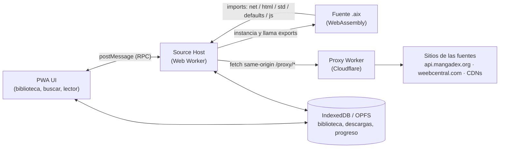

# SPEC v0.1 — Tinta, lector PWA compatible con Aidoku

- **Estado:** borrador para revisión (2026-10-14)
- **Repo:** `Angelus-GS/Tinta`
- **Idea en una línea:** un lector de manga como PWA que actúa como *host* de fuentes
  Aidoku (`.aix`, WebAssembly) en el navegador — no un port de KOReader.

---

## 1. Objetivo

Construir una aplicación web instalable (PWA), offline-first, capaz de:

1. Instalar fuentes desde listas de fuentes compatibles con Aidoku
   (`index.min.json` + paquetes `.aix`).
2. Ejecutar el WebAssembly de cada fuente en un Web Worker, implementando en
   JavaScript/TypeScript los *imports* que el ABI de Aidoku exige al host.
3. Buscar manga, ver detalle y capítulos, leer páginas en línea y descargar
   capítulos para lectura offline.

### 1.1 No-objetivos (fuera de alcance)

- No es un port de KOReader: no se porta Lua, LuaJIT, CREngine ni MuPDF.
- No ejecuta plugins `.koplugin` de Lua (incluido Rakuyomi como binario nativo:
  su backend Rust con socket Unix y SQLite no existe en un navegador).
- No soporta fuentes que requieran **webview** interactivo (login o reto
  anti-bot en página real). Esos imports se devuelven como no soportados,
  igual que hace Rakuyomi.
- No evade DRM, paywalls ni protecciones anti-bot. Solo se automatiza el
  acceso a sitios que el usuario puede abrir y leer en su navegador.
- EPUB/PDF locales no son parte del MVP (fase posterior, ver §9).
- **No se toca el repo `vive-la-resistance`** (app en producción del
  usuario): el lector vive en repo y despliegue propios. La alternativa de
  meterlo como módulo dentro de esa app quedó descartada por riesgo.

## 2. Fuentes de aceptación (criterio de “funciona”)

El host se considera correcto solo si corre **las dos**, sin código especial
para ninguna:

| Fuente | Tipo | Qué ejercita del host |
|---|---|---|
| **MangaDex** (`multi.mangadex`) | API REST / JSON | `net` (incl. `send_all`, `set_body`, rate-limit), `defaults` (get/set), `std` (fechas), postcard |
| **Weeb Central** (`en.weebcentral`) | Scraper HTML | Módulo `html` completo (selectores CSS, `text`, `attr`, navegación), `net.html`, `send_partial_result` |

Ambas existen como `.aix` verificados a nivel binario en la literatura del ABI
(MangaDex v12, Weeb Central v6, auditados el 2026-02-19 en el loader de
referencia citado en §12). Se fijarán (*pin*) los `.aix` exactos descargados de
la lista oficial de Aidoku Community Sources como *fixtures* de prueba.

### 2.1 Flujos de aceptación por fuente

Para cada fuente de aceptación, de principio a fin:

1. Instalar desde la lista de fuentes.
2. `get_search_manga_list`: buscar un título conocido y obtener resultados
   con portada.
3. `get_manga_update`: abrir un título y obtener detalle + lista de capítulos.
4. `get_page_list`: abrir un capítulo y obtener todas sus páginas.
5. Leer el capítulo en el lector (paginado, dirección RTL).
6. Descargar el capítulo y leerlo offline (modo avión).

## 3. Arquitectura general



### 3.1 Componentes

| Componente | Responsabilidad |
|---|---|
| **App shell (PWA)** | UI, service worker, manifest, caché del shell. |
| **Source Manager** | Descargar listas (`index.min.json`), instalar/actualizar/desinstalar `.aix`, leer su manifiesto. |
| **WASM Host (Worker)** | Instanciar fuentes, registry de buffers (RID), implementar imports, decodificar resultados postcard. |
| **Postcard codec** | Codificar/decodificar los tipos de aidoku-rs (ver §5). |
| **Proxy** | Reenviar peticiones sin CORS (ver §6). |
| **Library Store** | Persistencia local (ver §7). |
| **Reader** | Presentación de páginas (ver §8). |
| **Downloader** | Cola de descargas de capítulos a OPFS, reanudable. |

## 4. Formato `.aix`

Un `.aix` es un ZIP con rutas con `/` (forward slashes obligatorios):

```
Payload/main.wasm     # la fuente compilada (wasm32-unknown-unknown)
Payload/icon.png      # icono instalado (si falta, placeholder)
Payload/source.json   # manifiesto: info.id, info.name, info.version, info.url,
                      #   info.languages, info.contentRating; listings y config opcionales
Payload/filters.json  # filtros de búsqueda (opcional)
Payload/settings.json # definiciones de ajustes de la fuente (opcional)
```

> **Errata verificada en Fase 0 (2026-10-15)** contra los paquetes reales del
> catálogo comunitario (MangaDex v14, Weeb Central v8): TODO vive dentro de
> `Payload/` — no existe carpeta `res/` en los paquetes actuales, aunque
> documentación de terceros la mencione. La instalación debe aceptar ambas
> rutas (`Payload/` preferente, `res/` como respaldo), pero la canónica es
> `Payload/`.

La instalación valida: ZIP íntegro, `main.wasm` presente y compilable,
`source.json` válido contra el esquema de aidoku-rs, e icono si existe.

## 5. Contrato ABI con las fuentes

Referencia: ABI de aidoku-rs (SDK “next”) tal como fue verificado contra los
binarios reales de MangaDex, Weeb Central, AsuraScans y MangaFire.

### 5.1 Exports (el host llama a la fuente)

Todos devuelven `i32`: positivo = puntero a buffer de resultado en memoria
lineal (`[u32 len LE][u32 capacity LE][payload postcard]`); cero = éxito sin
payload; negativo = error (`-1` general, `-2` no soportado, `-3` login
requerido). El host debe llamar `free_result(ptr)` al terminar.

Obligatorios (trait `Source`):

| Export | Parámetros | Devuelve |
|---|---|---|
| `start` | — | Inicializa la fuente; se llama antes que todo. |
| `get_search_manga_list` | `query_rid, page (1-indexado), filters_rid` | `MangaPageResult` |
| `get_manga_update` | `manga_key_rid, needs_details, needs_chapters` | `Manga` (detalle y/o capítulos) |
| `get_page_list` | `manga_descriptor_rid, chapter_descriptor_rid` | Lista de `Page` |

Opcionales (según traits que la fuente implemente): `get_manga_list`,
`get_listings`, `get_home`, `get_filters`, `get_settings`,
`get_alternate_covers`, `get_image_request`, `get_base_url`,
`get_page_description`, `process_page_image`, `handle_notification`,
`handle_deep_link`, `handle_basic_login`, `handle_web_login`,
`handle_key_migration`. El host los invoca solo si el módulo los exporta.

### 5.2 Convención RID

Los parámetros complejos viajan como **RID** (`i32`): el host guarda los bytes
serializados en un registry `Map<RID, Uint8List>`; la fuente lee con
`std.buffer_len(rid)` + `std.read_buffer(rid, ptr, len)` y libera con
`std.destroy(rid)`.

### 5.3 Imports (el host implementa para la fuente)

Cobertura observada en los binarios de aceptación — el host MVP debe
implementar **todos** los marcados, aunque una fuente concreta no los use:

| Módulo | Funciones | Notas |
|---|---|---|
| `env` | `print`, `abort`, `send_partial_result` (+ alias legacy con `_`) | Logs y resultados parciales en streaming. |
| `std` | `destroy`, `buffer_len`, `read_buffer`, `current_date`, `parse_date`, `utc_offset` | `parse_date` debe respetar formato/locale/timezone recibidos. |
| `net` | `init`, `send`, `send_all`, `set_url`, `set_header`, `set_body`, `set_timeout`, `data_len`, `read_data`, `get_status_code`, `get_header`, `html`, `set_rate_limit` | Ver decisión crítica §5.4. Métodos HTTP: `0=GET…5=HEAD`. |
| `html` | `parse`, `parse_fragment`, `select`, `select_first`, `text`, `own_text`, `attr`, `html`, `outer_html`, `size`, `get`, `first`, `last`, `parent`, `children`, `next`, `previous`, `tag_name`, `id`, `class_name` | MangaDex **no** usa este módulo; Weeb Central sí, casi entero. La semántica debe imitar a `scraper`/`ego-tree` de Rust, no a `querySelectorAll` sin más (ver §10 riesgos). |
| `defaults` | `get`, `set` | Persistencia por fuente con namespace `"<sourceId>.<key>"`; valores postcard con discriminante de tipo (Bool=1, Int=2, Float=3, String=4, StringArray=5, Null=6). Sembrar desde `res/settings.json` al instalar. |
| `js` | `context_create`, `context_eval`, `context_get` | Evaluación JS aislada dentro del Worker para fuentes que decodifican contenido ofuscado. MVP: puede devolverse error y marcar la fuente como parcial. |
| `js` (webview) | `webview_create`, `webview_load`, `webview_load_html`, `webview_wait_for_load`, `webview_eval` | **Stub:** devolver `-1` siempre (§1.1). |

### 5.4 ⚠️ Decisión crítica: `net.send` es síncrono, `fetch` no

El ABI espera que `net.send(rid)` bloquee y devuelva la respuesta; en web,
`fetch` es asíncrono y un import de WASM no puede esperar una promesa sin
mecanismo extra. Es **el** riesgo del proyecto. La Fase 0 (§9) es un spike
para elegir y demostrar una de estas rutas, en este orden de preferencia:

1. **JSPI** (WebAssembly JavaScript Promise Integration) — limpio, pero su
   disponibilidad depende del navegador.
2. **Asyncify** (transformación Binaryen del `.aix`) — compatible en más
   navegadores; costo: binario mayor y posible fricción con fuentes futuras.
3. **Worker + `Atomics.wait` + XHR síncrono al proxy** — funciona sin
   transformar binarios; requiere aislamiento cross-origin (COOP/COEP) para
   `SharedArrayBuffer` y un proxy que acepte XHR síncrono.

La decisión y su justificación quedan en un ADR (`docs/adr/0001-net-sync.md`)
antes de escribir el host completo. **Dispositivo objetivo principal influye
directamente en esta elección** (ver §11).

> **Resuelto en Fase 0 (2026-10-15):** detección en runtime — **JSPI**
> cuando el navegador lo trae y **Asyncify** como respaldo; la ruta
> SAB/`Atomics.wait` quedó descartada como mecanismo por defecto porque
> GitHub Pages no puede emitir las cabeceras COOP/COEP que exige. Ver
> ADR-0001 y `spike/FINDINGS.md`. Nota: el spike demostró la semántica con
> HTTP bloqueante en Node; el transporte de navegador se construye en
> Fase 1 sobre esta decisión.
>
> **Ajuste en producción (2026-10-15):** el respaldo implementado en Fase 1
> es XHR síncrono en el worker (sin Asyncify todavía). Safari 27 ya expone
> JSPI, pero su implementación rompe la ejecución de la fuente
> (`get_search_manga_list` devolvía -3 desde `std.read_buffer` en un iPhone
> real); por eso el host **desactiva JSPI en navegadores AppleWebKit sin
> Chrome** (Safari y todo navegador iOS) y usa el respaldo, que pasó la
> aceptación completa (búsqueda → capítulos → 49/49 páginas) a través del
> proxy. Chromium/Firefox siguen en la ruta JSPI.

### 5.5 Codec postcard

Los payloads van en **postcard** (formato binario de serde: varints, strings
con longitud prefijada, enums por discriminante `u8`/`varint`). Hay que
implementar encoder/decoder en TS para los tipos de aidoku-rs que cruzan la
frontera (`Manga`, `Chapter`, `Page`, `MangaPageResult`, `FilterValue`,
`Listing`, `HomeComponent`, `ImageRequest`, descriptores…) y probarlo contra
salidas reales capturadas de los `.aix` fixture (golden tests, §10). Las
fuentes fijan revisiones distintas de aidoku-rs en su `Cargo.lock`; el codec
debe tolerar campos añadidos al final de structs (compatibilidad hacia
adelante) y fallar con error legible, nunca con datos corruptos en silencio.

## 6. Proxy anti-CORS

### 6.1 Por qué existe

- `api.mangadex.org` solo envía `Access-Control-Allow-Origin` para orígenes
  `localhost`; una PWA en un dominio público no puede llamarlo directo.
- Weeb Central no ofrece API ni cabeceras CORS útiles para este uso.
- Las portadas de MangaDex (`uploads.mangadex.org`) sí tienen CORS correcto,
  pero las páginas de capítulo se sirven desde nodos *MangaDex@Home* con
  dominios dinámicos.

### 6.2 Diseño (Cloudflare Worker)

- Ruta same-origin: `/proxy/<url codificada>` (o subdominio propio); la PWA
  nunca llama directo a las fuentes para contenido del host WASM.
- **Allowlist estricta:** solo dominios derivados de los manifiestos de las
  fuentes instaladas (`info.url`) + patrones explícitos para CDNs de imagen
  (p. ej. nodos `*.mangadex.network`). Nada de proxy abierto (evita abuso y
  SSRF).
- Cabeceras: fijar `User-Agent`/`Referer` que la fuente pida, reenviar
  cookies solo si la fuente las configuró explícitamente.
- Rate limiting: respetar el `set_rate_limit` que declare cada fuente y los
  límites públicos de MangaDex; caché de portadas/páginas con Cache API.
- Sin credenciales del usuario hacia terceros salvo las que él configure por
  fuente; nada de analítica sobre hábitos de lectura.

## 7. Modelo de datos local

IndexedDB (metadatos) + OPFS (binarios: `.aix` instalados, páginas
descargadas):

| Entidad | Contenido |
|---|---|
| `sources` | id, versión instalada, manifiesto, bytes del `.aix`, ajustes (`defaults`). |
| `sourceLists` | URL de la lista, fecha de refresco, catálogo disponible. |
| `library` | Manga guardados: clave compuesta `(sourceId, mangaKey)`, snapshot de `Manga`, última lectura. |
| `chapters` | Por manga: `Chapter` + estado (leído/en curso), progreso. |
| `downloads` | Capítulo → páginas en OPFS, bytes totales, estado de la descarga. |
| `progress` | `(sourceId, mangaKey, chapterKey)` → página y timestamp (formato propio, exportable). |
| `settings` | Ajustes globales del lector y por fuente. |

Exportación: un capítulo descargado puede exportarse como **CBZ** (las
páginas ya son imágenes ordenadas), para leerlo en KOReader u otro lector.

## 8. Lector

MVP: paginado (una página, dirección RTL y LTR), toque/botones/teclado para
pasar página, precarga de páginas siguientes, zoom básico, modo scroll
vertical como alternativa. Sin animaciones costosas (pensado también para
pantallas de tinta vía navegador del e-reader, sin prometer paridad con una
app nativa).

## 9. Fases

| Fase | Entregable | Criterio de salida |
|---|---|---|
| **0. Spike ABI** ✅ (2026-10-15) | Host mínimo (Node) que carga el `.aix` de MangaDex y corre la cadena completa **contra la API real** (superó el criterio original, que pedía red simulada): buscar → detalle+capítulos → lista de páginas, todo decodificado byte-exacto; ADR-0001 escrito. Ver `spike/FINDINGS.md`. | ✅ Búsqueda, update (929 caps. de One Piece) y páginas (51 de Yotsuba, imagen HTTP 200) verificados. |
| **1. MVP MangaDex** ✅ (2026-10-15) | Source Manager + proxy + host en Web Worker + lector mínimo, MangaDex real de principio a fin. Verificado en Chromium 155 real: **JSPI activo**, instalar desde el catálogo → buscar “Yotsuba” (20 resultados) → detalle con 137 capítulos → lector con **49/49 páginas cargadas** desde `*.mangadex.network`, cero errores de consola. El proxy está escrito y documentado (`proxy/`); su despliegue en la cuenta del usuario es lo único pendiente para que el origen público funcione (desde `localhost` MangaDex responde directo). | ✅ Flujo §2.1 completo con MangaDex en navegador real. |
| **2. Weeb Central** ✅ (2026-10-16) | Módulo `html` completo en JS puro (`app/lib/html.js`: parser HTML + selectores CSS con la semántica de `scraper`/SwiftSoup, incluidos `:has()` y `:contains()`) + ajustes del proxy para scraping. Verificado en Chromium real, en **ambos transportes** (JSPI y respaldo XHR síncrono) y a través del proxy desplegado: instalar Weeb Central v8 → buscar “One Piece” (5 resultados) → detalle con **1196 capítulos** → capítulo leído con **17/17 páginas cargadas** desde el CDN de la fuente; MangaDex sin regresión (20 resultados, 49/49). Hallazgos en `spike/FINDINGS.md`. | ✅ Flujo §2.1 completo con Weeb Central, sin código específico para ella. |
| **3. Biblioteca y offline** ✅ (2026-10-16) | Biblioteca persistente y descargas en **IndexedDB** (la spec decía OPFS; IDB resultó más portable entre navegadores, Safari incluido), progreso de lectura, **importación** de CBZ local y las mejoras del lector de §8: modo por páginas con zonas de toque y dirección LTR/RTL configurable y persistida, capítulos agrupados por volumen, marcas de avance («pág. N» / «✓ leído», retomar al reabrir), logo «Tinta» → inicio y **precarga** del capítulo siguiente en la lista (configurable en Ajustes, 1 por defecto) usando el mismo almacén de descargas. Verificado en Chromium real, en **ambos transportes** (JSPI y respaldo XHR síncrono) y a través del proxy desplegado: sin regresión en Fases 1–2 (Yotsuba 49/49, One Piece 17/17, Spy x Family 23/23); la biblioteca persiste tras recargar y el detalle se abre desde la copia guardada sin conexión; un capítulo descargado a mano (23/23 págs.) y el precargado (20/20) se leyeron **completos con la red bloqueada**, servidos desde blobs locales; un CBZ de prueba se importó y leyó en orden natural (1, 2, 10). Pendiente honesto: la **exportación** a CBZ no se implementó en esta fase (solo importación y lectura). | ✅ Leer offline (descarga manual y precargada) y biblioteca persistente verificados en navegador real. |
| **Ronda 2 de mejoras** ✅ (2026-10-16) | **Favoritos en el home** (v1.6.0): estrella en el detalle que marca `favorite` sobre el registro de la biblioteca (favorito implica guardado, con snapshot; quitar la estrella solo quita la marca — el manga permanece en la biblioteca) y sección «Favoritos» con portadas al principio de la vista inicial. **Lector paginado inmersivo a pantalla completa**: en modo por páginas se ocultan la cabecera de la app y las barras del lector, fondo negro y página al máximo (Fullscreen API donde el navegador la ofrece; en iOS basta la inmersión CSS), con **encuadre configurable** en Ajustes y desde el propio lector: *Ajustar* (`object-fit: contain`, página completa visible, por defecto) o *Llenar* (`cover`, sin bordes, recorta). Toque en la zona central muestra/oculta una barra mínima (salir, título, página x/y, encuadre y modo) sin tocar las zonas laterales de avance ni la dirección LTR/RTL. Verificado en Chromium real en **ambos transportes**: favorito → home → persiste tras recargar → se abre desde el home → desmarcar lo saca del home y queda en la biblioteca; geometría inmersiva al 100% del viewport con cabecera oculta; regresiones sin cambios (Yotsuba 49/49 en scroll, Weeb Central buscando, descargas/biblioteca de la Fase 3 intactos). | ✅ Favoritos persistentes en el home y página a pantalla completa verificados en navegador real. |
| **Ronda 3 de mejoras** ✅ (2026-10-17) | **Lista de capítulos paginada con orden viejo→nuevo por defecto** (v1.7.0), pedido literal del usuario («agregar la paginación e iniciar con los tomos más viejos a los más nuevos»). La lista ya no renderiza cientos de filas: páginas **por volumen** cuando la fuente trae `volume_number` (un volumen por página, con su cabecera; un volumen con más de 100 capítulos se subdivide en bloques de 100) y **bloques de 50** cuando no hay volúmenes, con paginador arriba y abajo («Volumen N · x de y» / «Página x de y»). El orden de despliegue por defecto es **ascendente** (el tomo más viejo primero), con botón visible y selector en Ajustes para invertirlo (nuevo→viejo); la preferencia persiste en `localStorage`. El orden cronológico real (`state.currentChapters`, tal como lo devuelve la fuente) no se toca: avance, descargas y precarga operan sobre él; «Continuar leyendo» abre el capítulo directamente y, **al volver del lector, la paginación salta a la página donde vive ese capítulo**. De propina se serializaron los guardados de progreso (una cadena de promesas): el observador de scroll disparaba guardados get→put concurrentes y uno viejo podía pisar la página final, dejando la marca en «pág. N» en vez de «✓ leído». Verificado en Chromium real en **ambos transportes** (JSPI y respaldo XHR síncrono) a través del proxy desplegado: Yotsuba abre en **Volumen 1** con primer capítulo **Cap. 1** (11 filas), paginador «Volumen 1 · 1 de 16», Siguiente → Volumen 2; orden invertido muestra Volumen 16 y **persiste tras recargar**; lector Cap. 114 con **47/47** páginas y marca «✓ leído»; Continuar salta la lista de Volumen 2 a **Volumen 16** al volver; precarga registrada en IDB. One Piece en Weeb Central (1196 capítulos, sin `volume_number`): **50 filas por página**, «Página 1 de 24» empezando en **Cap. 1** y página 2 en Cap. 51. | ✅ Lista paginada empezando por el tomo más viejo, verificada en navegador real en ambos transportes. |
| **Ronda 4 de mejoras** ✅ (2026-10-17) | **Las cuatro pedidas por Calíope y aceptadas por el usuario («hagamos las más que podamos»), más la banca completa** (v1.8.0). **(1) Búsqueda global**: buscador en el home que consulta **todas las fuentes instaladas en serie** (en el transporte síncrono cada llamada ocupa el worker hasta volver), con progreso por fuente («Buscando en X…») y resultados agrupados bajo la cabecera de cada fuente; el fallo de una fuente se anota en su grupo y no aborta a las demás, y cada tarjeta abre el detalle en su fuente. **(2) Aviso de capítulos nuevos**: cada registro de biblioteca/favoritos guarda su «conocido» (conteo de capítulos + capítulo más reciente, sembrados al guardar y al abrir el detalle); el botón «Buscar novedades» del home — y un chequeo automático como máximo una vez al día al abrir la app — consulta la lista de cada serie guardada, acumula la diferencia en una insignia **+N** sobre las tarjetas del home/biblioteca y la limpia al abrir el detalle; los fallos por serie se toleran en silencio. **(3) «Seguir leyendo» global**: riel en el home con las últimas lecturas de **todas** las series (máx. 12, la más reciente primero; el registro de avance ahora también guarda título, portada y total de páginas del capítulo en curso); tocar una tarjeta entra por el detalle y reabre el capítulo en la página guardada, y la ✕ de la tarjeta solo la descarta (reaparece si el avance cambia: **no** borra el progreso). **(4) Ir al capítulo N + descargar por rango**: campo «Ir al cap. N» que salta la paginación a la página del capítulo pedido (o al más cercano) y lo resalta, y descarga en cola de todos los capítulos entre dos números reutilizando la tubería offline existente (progreso global, cancelable entre capítulos, misma tienda). **Banca**: **exportación a CBZ** (escritor ZIP propio, método *stored*, páginas `0001.ext…` en orden, botón en cada capítulo descargado — cierra la deuda de la Fase 3); **tema del lector** (Ajustes → Fondo: Negro / Papel cálido / Blanco, aplicado en scroll e inmersivo); **respaldo** en JSON (biblioteca, favoritos, avance y ajustes; importar restaura todo — fuentes y descargas no viajan). **Hallazgo cazado por la aceptación**: el chequeo de novedades fallaba en silencio con `Cannot convert undefined to a BigInt` — `encManga` exige campos numéricos no opcionales (`status`, `content_rating`, `viewer`, `update_strategy`) y el *stub* guardado en biblioteca es mínimo (`{key,title,cover}`); el update ahora se intenta con el **snapshot completo** cuando el stub no trae esos campos (también al abrir el detalle desde la biblioteca o el riel), y sin snapshot el riel puede no cargar capítulos frescos (límite documentado). Otro dato de dominio: MangaDex **duplica capítulos por grupo de scanlation** (dos «Cap. 1» con distinta clave), así que el rango por número los descarga como entradas separadas. Verificado en Chromium real en **ambos transportes** (JSPI y respaldo XHR síncrono) a través del proxy desplegado: búsqueda global de «One Piece» → **MangaDex 20 / Weeb Central 5** con detalle abierto desde el grupo; avance guardado → riel → reapertura en la **página exacta**; conocido sembrado en −3 → insignia **+3** y limpieza al abrir; «Ir al cap.» → Yotsuba **Volumen 8** (cap. 50) y One Piece **página 17 de 24** (cap. 850); rango 1–2 → capítulos en la tienda offline y **lectura con la red cortada**; CBZ exportado válido (**48 entradas**, 7.2 MB); tema papel con fondo calculado `rgb(245,236,215)`; respaldo exportado → biblioteca borrada → importada y restaurada; regresiones intactas (orden/paginación/favoritos de la Ronda 3, capítulo MangaDex **48/48** en scroll). | ✅ Las 7 funciones verificadas en navegador real en ambos transportes. |
| **Corrección v1.8.1** ✅ (2026-10-18) | **Dos defectos reportados por el usuario en su iPhone + etiqueta de fuente.** **(1) Glifo de imagen al centro en cada avance del lector paginado**: `paintPaged()` creaba un `` nuevo por página y lo mostraba vacío mientras bajaba por el proxy (Safari pinta su glifo en el hueco). Ahora las páginas vecinas (3 siguientes + anterior, en orden de lectura) se **precargan** con `Image()` fuera de pantalla — con la misma red proxy→directo — y la página nueva **no se revela hasta su `load`**: la anterior queda visible cubriendo el hueco, con un indicador de carga discreto en el escenario; si la pedida ya estaba precargada, el cambio es instantáneo y sin red. El mismo «ocultar hasta `load`» se aplicó al modo scroll (solo opacidad: el IntersectionObserver no se entera). **(2) Botón de descarga que fallaba**: la causa raíz de fondo era de dominio — las páginas de Spy x Family (Weeb Central) viven en `official.lowee.us`, fuera de la allowlist del proxy (403) y sin CORS en directo: leer se salvaba por el ``, descargar no (corrección del Worker por separado) — y el código lo agravaba: `refreshDlButtons()` reactivaba el botón en capítulos **bloqueados** (`locked`/`isUnavailable` de MangaDex) y el toque moría contra la API con error crudo — ahora el botón de un capítulo bloqueado queda **deshabilitado siempre**, con título «No disponible en esta fuente» — y `downloadChapter()` abortaba el capítulo entero al primer error de página con un toast genérico: ahora cada página **reintenta** (proxy → directo → proxy, con pausas) y el error final dice **página N · host · HTTP xxx / error de red**, la pista para diagnosticar el próximo dominio desconocido. Limpieza de parciales intacta: una descarga incompleta no se registra. **(3) Fuente visible**: la ficha del manga muestra «Fuente: X» bajo el título (las tarjetas de biblioteca/favoritos ya la traían en su línea secundaria; el riel «Seguir leyendo» la suma). Verificado en Chromium real en **ambos transportes**: avance paginado con páginas precargadas visibles al instante, botón deshabilitado en capítulo bloqueado de MangaDex, descargas de Weeb Central (lowee y planeptune) y MangaDex completas con lectura sin red, y toast de error con página y host ante un 403 forzado. |
| **Ronda 5 de mejoras** ✅ (2026-10-19) | **Dos mejoras del lector pedidas por el usuario (las 2 y 3 de la lista de Calíope)** (v1.9.0). **(2) Recorte de márgenes**: preferencia `tinta.trimMargins` (Ajustes → «Recortar márgenes de página», apagada por defecto, con interruptor rápido «Recorte: Sí/No» en los controles del lector). Por página: muestreo a baja resolución en canvas de una **sonda CORS aparte** (`crossOrigin='anonymous'`; el `` visible se cargó sin CORS y dibujarlo contaminaría el canvas — las imágenes vía proxy traen ACAO * y las descargadas son blobs; si un origen no da CORS, la sonda falla y esa página se queda sin recorte y sin error). La sonda se dispara al precargar cada vecina, así la caja ya está lista al avanzar. Color de borde = **mediana de 8 parches perimetrales** (un número de página impreso en una esquina no veta la detección; sin acuerdo de ≥5 parches no hay conclusión), filas/columnas uniformes de ese color (≥97% de píxeles dentro de tolerancia) con tope del **40% por lado**; la caja se cachea en memoria por URL. La presentación es pura geometría CSS (`.trim-box` con overflow hidden y el `` expandido según las fracciones) respetando el encuadre vigente (Ajustar/Llenar), sin tocar la tubería de pintar-al-load ni la precarga; aplica al modo por páginas (el scroll conserva su pipeline con IntersectionObserver intacto). **(3) Páginas dobles en horizontal**: preferencia `tinta.spreads` (Ajustes → «Páginas dobles al girar el teléfono», encendida por defecto). Solo en modo por páginas con viewport horizontal: dos páginas consecutivas lado a lado como un solo paso, indicador con rango («12–13 / 200»), avance/retroceso **de vista en vista** anclado en la primera del par; en RTL la primera del par se lee a la **derecha**. Las vistas se calculan voraces desde el inicio del capítulo: una página **panorámica** (ancho/alto ≥ 1.2) va sola a todo el ancho y no se empareja, el total impar cierra en página sola, y al volver a vertical la vista queda anclada en la primera página del par. El avance guardado sigue siendo el índice de la primera página visible y la precarga cubre el par siguiente; el aspecto de cada página se anota al cargarla (precarga o pintado) y la vista se corrige si un aspecto nuevo la cambia. Girar el teléfono re-pinta sin mover el ancla. Verificado en Chromium real en **ambos transportes** (JSPI y respaldo XHR síncrono, suite `run-e2e-ronda5.mjs`: **21/21 en cada uno**): recorte concluyente en las 5 páginas muestreadas de Yotsuba Cap. 1 (fracciones 0–0.046 por lado, 4/5 con caja, área visible efectiva **+1.3%** en agregado frente a sin recorte, identidad exacta al apagarlo), desplegados con indicador de rango («5–6 / 48») y saltos de +2 (inversión visual en RTL, página sola al final del Cap. 5 de 29), composición recorte+desplegados sin errores, y regresiones intactas (avance instantáneo con precarga de la v1.8.1; scroll completo 47/47 en el Cap. 114 de control — la fuente lo sirve hoy con 47 páginas). |
| **Hotfix v1.9.1** ✅ (2026-10-19) | **Error «Invalid argument type in ToBigInt operation» al abrir «Dandadan» desde el riel** (reportado por el usuario en su iPhone, transporte XHR síncrono; es la redacción JavaScriptCore de «Cannot convert undefined to a BigInt»). Cadena causal: una serie con avance guardado pero **sin registro en biblioteca**, abierta desde «Seguir leyendo», llamaba a `openManga` sin snapshot; el guard solo exigía `status !== undefined` para usar el stub tal cual y, si no, caía a `opts.snapshot || mangaStub` = el **stub mínimo desnudo** `{key,title,cover}` — y `encManga` revienta en `BigInt(undefined)` al codificar `status`/`content_rating`/`viewer`/`update_strategy`. Era el «límite conocido del stub» documentado en la Ronda 4: desaparece. **Arreglo en la capa de la app** (`app/main.js`; el codec y el worker no se tocaron): nuevo ayudante `completeMangaInput(stub)` que devuelve un Manga serializable completo — conserva key/title/cover y cualquier campo definido del stub (un `undefined` explícito nunca pisa un default), rellena los numéricos no opcionales con 0 y los opcionales con null — usado por `openManga` cuando el stub viene incompleto y no hay snapshot, y por `checkForUpdates` en su ruta sin snapshot (registros viejos). La fuente solo necesita la key para re-traer el detalle entero. Verificado en Chromium real en **ambos transportes** (suite `run-e2e-fixes191.mjs`: **9/9 en cada uno**, números idénticos): Dandadan (Weeb Central) solo-con-avance desde el riel → detalle sin «BigInt», **50 filas** de capítulos y el lector reabre el capítulo guardado (**67 imágenes**); Yotsuba to! (MangaDex) en el mismo escenario → sin «BigInt», **11 filas** y lector con **48 imágenes** (ambas fuentes aceptan el update con el stub completado); regresiones intactas (búsqueda global de MangaDex y ruta biblioteca/snapshot) y **cero pageerrors**. |
| **4. (Posterior)** | Más fuentes del catálogo, EPUB/PDF locales, sincronización de progreso tipo KOReader Sync. | Fuera del compromiso inicial. |

Estimación honesta (inferencia, no compromiso): Fase 0, días; Fases 1–2,
semanas; Fase 3, semanas. El codec postcard y la semántica de `html` son los
dos frentes que pueden mover la estimación.

## 10. Pruebas

- **Auditoría de imports:** script que lista `WebAssembly.Module.imports()`
  de cada `.aix` fixture y verifica cobertura del host (equivalente web de la
  auditoría con la que se documentó el ABI de referencia).
- **Golden tests de codec:** payloads postcard reales capturados ↔ objetos TS.
- **Fixtures HTTP:** respuestas grabadas de MangaDex y Weeb Central para
  probar fuentes sin tocar la red (y sin martillar los sitios).
- **Aceptación E2E:** el flujo §2.1 automatizado (Playwright) contra el proxy
  de desarrollo, más verificación manual en el dispositivo objetivo.

## 11. Preguntas abiertas

1. **Dispositivo objetivo principal:** ¿iPhone/iPad (Safari), Android/BOOX
   (Chromium), escritorio? Decide la ruta de §5.4 y el esfuerzo en e-ink.
2. ~~**Hosting:** ¿GitHub Pages + Cloudflare Worker propios?~~ **Resuelto
   (2026-10-14):** repo **público** con project site de GitHub Pages
   (`angelus-gs.github.io/Tinta`) + Cloudflare Worker para el
   proxy. En GitHub Free, Pages solo existe en repos públicos (privado
   requiere Pro), el límite de “un sitio” es por repositorio (sitios de
   proyecto) y el único sitio único es el de usuario (`<owner>.github.io`).
   Ojo: Pages no permite cabeceras HTTP personalizadas — si la ruta elegida
   en §5.4 exigiera COOP/COEP, el hosting de producción se mueve a
   Cloudflare Pages (que sí las permite vía `_headers`) sin cambiar el
   código. Pages es hosting estático: el proxy nunca puede vivir ahí, por
   eso es un Worker aparte desde el diseño.
3. ~~**Nombre/branding** del producto final (el nombre del repo es provisional
   y descriptivo).~~ **Resuelto (2026-10-14):** el producto se llama
   **Tinta** (repo `Angelus-GS/Tinta`).

## 12. Referencias

- aidoku-rs — SDK y libro de desarrollo de fuentes (traits `Source`,
  recursos `res/`, CLI `aidoku`).
- Aidoku Community Sources — lista oficial (`index.min.json`) y paquetes
  `.aix` de MangaDex y Weeb Central.
- *Aidoku WASM ABI* (loader en Dart de manga_backup_converter) — documento
  que verificó a nivel binario exports, imports, RID y postcard contra
  MangaDex v12, Weeb Central v6, AsuraScans v11 y MangaFire v5.
- Rakuyomi — prueba de concepto previa de correr fuentes Aidoku fuera de
  Aidoku (sobre KOReader, con backend Rust); de ahí sale el límite de
  fuentes webview.
- KOwasm — experimento de KOReader en WASM; descarta el port literal como
  ruta para este proyecto (Lua 5.4 sin LuaJIT, FFI acotado, sin red pública).
